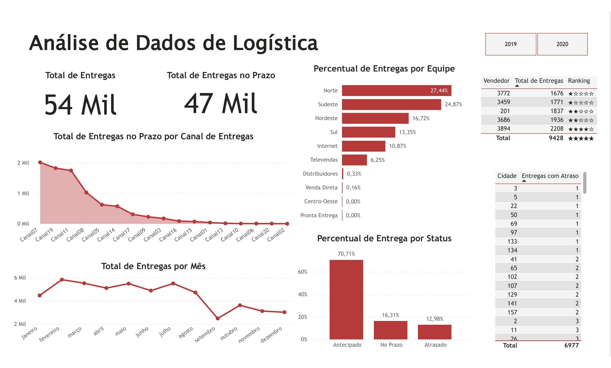

#  Mini Projeto 04 - Análise de Dados de Logística com Power BI

##  Sobre o projeto

Este projeto apresenta uma análise de dados de logística desenvolvida no Power BI, com foco no acompanhamento das entregas, cumprimento de prazos, desempenho por equipe, canais de entrega e evolução mensal.

O dashboard foi desenvolvido para facilitar a visualização dos principais indicadores logísticos e apoiar a análise do desempenho das entregas.

##  Ferramentas utilizadas

- Power BI
- Power Query
- DAX

##  Indicadores analisados

- Total de entregas
- Total de entregas no prazo
- Percentual de entregas por equipe
- Total de entregas por canal de entrega
- Total de entregas por mês
- Percentual de entregas por status
- Entregas com atraso por cidade
- Ranking de vendedores
- Comparativo entre 2019 e 2020

##  Dashboard

##  Principais análises

O dashboard apresenta indicadores como:

- **54 mil** no total de entregas;
- **47 mil** entregas no prazo;
- **70,71%** das entregas realizadas antecipadamente;
- **16,31%** das entregas realizadas no prazo;
- **12,98%** das entregas realizadas com atraso.

Também são apresentados gráficos de evolução mensal, distribuição das entregas por equipe e canal, além de tabelas de ranking e acompanhamento de atrasos por cidade.

##  Objetivo

Desenvolver um dashboard interativo para análise do desempenho logístico, permitindo acompanhar os principais indicadores de entrega e identificar informações relevantes sobre prazos, equipes, canais e períodos.

---

 **Projeto desenvolvido para fins de estudo e portfólio em Análise de Dados e Power BI.**
